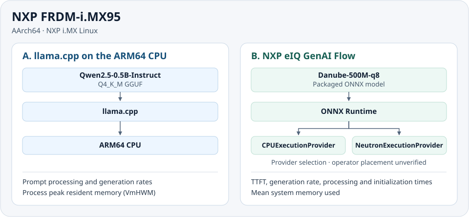

# Optional lab: Run quantized language models on the NXP FRDM-i.MX95

This optional lab uses the NXP FRDM-i.MX95 to measure local inference on embedded
Linux. Each path works independently, so you can complete either one.
The results come from physical-board captures. The setup and run examples in
this guide are reproduction instructions. The complete instructions have not
been replayed on the board.

- **Path A** builds llama.cpp and runs a Qwen2.5-0.5B-Instruct GGUF on the ARM64
  CPU. You will measure prompt processing, text generation, and process memory.
- **Path B** runs the same packaged Danube-500M-q8 ONNX model and question set
  twice in NXP eIQ GenAI Flow. You will compare the CPU and Neutron
  execution-provider settings.

This community-contributed lab applies [quantization and model format choices](../../01.Introduce.md)
and the [llama.cpp build and run workflow](../../02.Llamacpp.md) to embedded Linux.
The [Olive lesson](../../03.MicrosoftOlive.md) covers ONNX optimization and provider
selection. This lab starts with a model already packaged by NXP. Use the
[workflow synthesis lesson](../../06.workflow-synthesis.md) to relate the measurements
to your own latency, throughput, and memory requirements.



## Board prerequisites and recorded setup

Start with an FRDM-i.MX95 running NXP Linux and accessible through a shell.
Use NXP's FRDM-IMX95 guide to install or boot a board support package (BSP) on
a fresh board. Path A needs an AArch64 C/C++ compiler and CMake on the board.
The source archive and model can be downloaded on a Linux workstation and
transferred to the board. [NXP FRDM-IMX95 getting started guide](https://www.nxp.com/document/guide/getting-started-with-frdm-imx95:GS-FRDM-IMX95)

| Property | Configuration from the contributor's board notes and benchmark records |
| --- | --- |
| Board | NXP FRDM-IMX95 rev2.0 (AArch64) |
| Linux distribution | NXP i.MX Distro 6.18-wrynose |
| Kernel | `6.18.37-2.1.0-g6e694eda40aa` |
| Linux-visible RAM and swap | 7.5 GiB RAM, no swap |
| Contiguous Memory Allocator (CMA) | `CmaTotal: 5177344 kB` as displayed by Linux |
| Neutron device and firmware | `/dev/neutron0` present, firmware `3.2.1-0X0bcd547b` |
| Vendor ONNX Runtime | 1.24.3, build commit `2412fcb81` |

Use these read-only checks to compare your board with the recorded setup:

```bash
tr -d '\0' < /proc/device-tree/model
printf '\n'
uname -m
uname -r
cat /etc/os-release
grep -E '^(MemTotal|SwapTotal|CmaTotal|CmaFree):' /proc/meminfo
ls -l /dev/neutron0
```

### Neutron prerequisites

NXP documents Neutron LLM support for i.MX95 B0 with a compatible BSP,
a Neutron-enabled device tree, the BSP's ONNX Runtime, and extended CMA.
The exact DTB and U-Boot settings used for the recorded runs are unknown.
`imx95-15x15-frdm-neutron.dtb` is a target in the matching NXP kernel source.
The target name alone cannot identify what the board booted. Follow the
BSP instructions for your board if the current image needs Neutron enabled.
The CPU workloads can run independently of Neutron.
[NXP Neutron troubleshooting](https://github.com/nxp-appcodehub/dm-eiq-genai-flow-demonstrator/blob/main/eiq_genai_flow/README.md#npu-issues) · [NXP kernel DTB target](https://github.com/nxp-imx/linux-imx/blob/6e694eda40aabd6671fca82b5416dbd76beeebb9/arch/arm64/boot/dts/freescale/Makefile#L1294-L1295)

## Path A: Run Qwen2.5-0.5B-Instruct with llama.cpp

### Download the source and model

The board benchmark used a Git archive of llama.cpp commit
`4ed88da2ea2a51edc158efe0ee2a1e452d75644d`. The captured binary reports
`build_commit: "unknown"` because the archive omits Git history. The recorded
source archive has SHA-256
`c447602080d2f1ba82655062935cbc0b3acb530363af838b10a63aabe2d757bc`. An archive
recreated with a different Git or compression version can have a different file
hash. [Pinned llama.cpp source](https://github.com/ggml-org/llama.cpp/tree/4ed88da2ea2a51edc158efe0ee2a1e452d75644d)

A small instruction-tuned model keeps disk and RAM requirements modest for
the CPU exercise. Q4_K_M uses 4-bit quantization for many weights and higher
precision for selected tensors. The GGUF is 491,400,032 bytes. The benchmark
reports 630,167,424 parameters and a `model_size` of 485,452,288
bytes, which counts tensor data. File size and process memory account for
different things, including model metadata on disk and runtime allocations in
memory.

The locally tested GGUF is identified by SHA-256
`74a4da8c9fdbcd15bd1f6d01d621410d31c6fc00986f5eb687824e7b93d7a9db`.
The pinned Qwen download publishes the same SHA-256 and byte count. The
original distributor and download route for the board copy remain unverified.
[Pinned Qwen file metadata](https://huggingface.co/Qwen/Qwen2.5-0.5B-Instruct-GGUF/blob/872f8a96064a1242ac3a3359cad77c3042548405/qwen2.5-0.5b-instruct-q4_k_m.gguf)

These acquisition commands recreate the source archive and download the
checksum-matched model. Run them on a Linux workstation, then copy
`llama-source.tar.gz` and the GGUF into `$HOME/imx95-lab` on the board.

```bash
mkdir -p "$HOME/imx95-lab"
cd "$HOME/imx95-lab"

llama_commit=4ed88da2ea2a51edc158efe0ee2a1e452d75644d
git clone --filter=blob:none --no-checkout https://github.com/ggml-org/llama.cpp.git llama-git
git -C llama-git archive --format=tar.gz "$llama_commit" > llama-source.tar.gz

model=qwen2.5-0.5b-instruct-q4_k_m.gguf
gguf_revision=872f8a96064a1242ac3a3359cad77c3042548405
gguf_repo=https://huggingface.co/Qwen/Qwen2.5-0.5B-Instruct-GGUF
curl --fail --location --output "$model" "$gguf_repo/resolve/$gguf_revision/$model"
```

### Verify the model and build llama.cpp

On the board, verify the downloaded or transferred GGUF. Continue once
`sha256sum` reports `OK`.

```bash
cd "$HOME/imx95-lab"
model=qwen2.5-0.5b-instruct-q4_k_m.gguf
gguf_sha256=74a4da8c9fdbcd15bd1f6d01d621410d31c6fc00986f5eb687824e7b93d7a9db
printf '%s  %s\n' "$gguf_sha256" "$model" | sha256sum -c -
```

The commands below configure a Release build for the CPU and build the
`llama-cli` and `llama-bench` targets. They are reproduction steps based on
the pinned source. The original build invocation was unavailable.

```bash
mkdir -p llama-src
tar -xzf llama-source.tar.gz -C llama-src

cmake -S llama-src -B llama-build \
  -DCMAKE_BUILD_TYPE=Release \
  -DGGML_CPU=ON -DGGML_CUDA=OFF -DGGML_VULKAN=OFF \
  -DLLAMA_OPENSSL=OFF
cmake --build llama-build --config Release --parallel 2 --target llama-cli llama-bench
```

### Run a sample prompt

Use the same shell and working directory for the remaining Path A commands.
This is an illustrative smoke test for the pinned CLI. The captured results
come from `llama-bench`.

```bash
./llama-build/bin/llama-cli -m "$model" -t 4 -n 64 \
  --conversation --single-turn \
  -p "Explain in two sentences why smaller language models are useful on edge devices."
```

### Measure throughput

The contributor's benchmark transcript records
`llama-bench -m <local GGUF> -p 128 -n 64 -t 4 -r 5 -o json`, where
`<local GGUF>` stands for the board's model path. The runnable example below
uses the same options with the lab's paths. The 128-token prompt and 64-token
generation tests are separate phases, each run five times on four threads. [llama-bench documentation](https://github.com/ggml-org/llama.cpp/blob/4ed88da2ea2a51edc158efe0ee2a1e452d75644d/tools/llama-bench/README.md)

```bash
mkdir -p my-results
./llama-build/bin/llama-bench -m "$model" -p 128 -n 64 -t 4 -r 5 -o json \
  > my-results/qwen2.5-0.5b-llama-bench-t4-p128-n64.json
```

| Phase | Mean tokens/s | Standard deviation, tokens/s |
| --- | ---: | ---: |
| Prompt processing, 128 tokens | 18.389055 | 0.004735 |
| Generation, 64 tokens | 11.970925 | 0.003726 |

The run reported the CPU backend. Each value is a mean over five repetitions
of its own test. Standard deviation describes how much the five rates varied.
These benchmark phases do not include an interactive time-to-first-token
measurement. [Throughput JSON](./results/qwen2.5-0.5b-llama-bench-t4-p128-n64.json)

### Measure process memory

A separate board run recorded one repetition per phase and `VmHWM` samples.
The polling loop and 0.2-second interval below are a reconstruction. The
original loop and interval are unverified. `VmHWM` is the process's peak
resident set size so far. Linux labels it `kB` and reports it in units of
1,024 bytes (KiB).

```bash
./llama-build/bin/llama-bench -m "$model" -p 128 -n 64 -t 4 -r 1 -o json \
  > my-results/qwen2.5-0.5b-llama-memory-run.json &
bench_pid=$!

while kill -0 "$bench_pid" 2>/dev/null; do
  awk '/^VmHWM:/ { print $2 }' "/proc/$bench_pid/status" 2>/dev/null || break
  sleep 0.2
done > my-results/qwen2.5-0.5b-llama-memory-kib.txt

wait "$bench_pid" && awk '
  { if ($1 > peak) peak = $1 }
  END {
    if (NR == 0) exit 1
    printf "Maximum observed VmHWM: %d KiB (%.2f MiB)\n", peak, peak / 1024
  }' my-results/qwen2.5-0.5b-llama-memory-kib.txt
```

The highest recorded sample was **758,624 KiB (740.84 MiB)**. Sampling ends
when the process exits, so report the maximum you observed. The board's
`/usr/bin/time -v` returned zero for RSS on this image, and this result uses
the `/proc` samples.
[Memory run JSON](./results/qwen2.5-0.5b-llama-memory-run.json) · [VmHWM samples](./results/qwen2.5-0.5b-llama-memory-kib.txt)

## Path B: Benchmark NXP's packaged Danube-500M-q8 model

### Check the vendor environment

Install NXP eIQ GenAI Flow and its packaged Danube-500M-q8 model using the
vendor instructions for your BSP. NXP supplies the same packaged INT8 ONNX
model for both settings. The linked public release is a setup reference.
The package revision and encrypted model checksum from the
recorded runs are unknown. A fresh installation was not verified for this lab.
[NXP installation guide](https://github.com/nxp-appcodehub/dm-eiq-genai-flow-demonstrator/blob/4440c4a979b251742e97b27543af5b09cbab96c9/eiq_genai_flow/README.md#installation-of-the-demonstrator-package)

From the installed demonstrator directory, activate the vendor virtual
environment and check the runtime before running the benchmark. These are
preflight examples.

```bash
source ./venv/bin/activate
python -c 'import onnxruntime as ort; print(ort.__version__, ort.__file__, ort.get_available_providers())'
eiq_genai_flow --help
```

The contributor reported both `CPUExecutionProvider` and
`NeutronExecutionProvider` in the vendor environment. For the Neutron run,
use the BSP-provided ONNX Runtime and check that it exposes the provider.
[NXP runtime troubleshooting](https://github.com/nxp-appcodehub/dm-eiq-genai-flow-demonstrator/blob/main/eiq_genai_flow/README.md#onnx-runtime-issues)

### Run the same questions with both providers

Check the question file selected by `benchmark_questions_file` in eIQ GenAI
Flow's `config.py`. If the installed file differs, point that setting to a local
copy of the pinned file for both runs. The two captured logs matched the pinned
file in question text and order. [Pinned 20-question set](https://github.com/nxp-appcodehub/dm-eiq-genai-flow-demonstrator/blob/4440c4a979b251742e97b27543af5b09cbab96c9/eiq_genai_flow/src/eiq_genai_flow/benchmark/data/questions.txt)

Run the commands separately in the same environment. `-i keyb` selects keyboard
input mode, `--output-mode text` selects text output, `-m` selects the model, and
`-b` runs the question file automatically. `--use-neutron` requests the Neutron
provider for the second run. Retrieval-augmented generation (RAG),
speech-to-text, and text-to-speech are off for both runs.

The contributor has a transcript of the CLI options for both runs, including
`--use-neutron` for the Neutron run. The archived reports confirm the settings
and selected providers. The shell lines below are reproduction examples
assembled from those settings and NXP's documented CLI syntax. [NXP benchmark mode](https://github.com/nxp-appcodehub/dm-eiq-genai-flow-demonstrator/blob/main/eiq_genai_flow/README.md#benchmark-mode) · [NXP Neutron option](https://github.com/nxp-appcodehub/dm-eiq-genai-flow-demonstrator/blob/main/eiq_genai_flow/README.md#llm-on-cpunpu-neutron)

```bash
# CPU baseline
eiq_genai_flow -i keyb --output-mode text -m danube-500M-q8 -b

# Neutron setting
eiq_genai_flow -i keyb --output-mode text -m danube-500M-q8 -b --use-neutron
```

Each run produces a summary JSON and a detailed log. Check the log's
`Actual ORT Execution Providers` field for `CPUExecutionProvider` in the first
run and `NeutronExecutionProvider` in the second. The recorded runs also matched
in input and generated token counts for each question. Response counts measure
completion. Output quality remains unevaluated.

### Recorded Danube results

Time to first token (TTFT) is the delay from starting an LLM request to receiving
the first generated token. The vendor's generation rate divides the output token
count by the processing time after TTFT. LLM processing time covers the entire
response, including TTFT. Initialization is the time to prepare the LLM before
the questions run. Mean system memory covers the whole board, including the
operating system and other running processes.

| Metric | CPU setting | Neutron setting |
| --- | ---: | ---: |
| Responses completed | 20/20 | 20/20 |
| Mean TTFT | 0.37 s | 0.19 s |
| Mean generation rate | 10.54 tokens/s | 14.08 tokens/s |
| Mean LLM processing time per question | 9.37 s | 6.95 s |
| LLM initialization time | 37.51 s | 221.14 s |
| Mean system memory used (MB as reported by NXP) | 2,269.86 | 4,118.57 |

The results folder contains five files copied from the original captures and
one derived per-question JSON. The [CPU summary](./results/danube-cpu.json)
and [Neutron summary](./results/danube-neutron.json) preserve the vendor's
JSON output. The [derived per-question data](./results/danube-per-question.json)
transcribes input and output token counts, processing time, generation rate,
and TTFT from the two logs in the order of the pinned question file.

### Scope of the captured evidence

The logs confirm application-selected providers for the two recorded runs.
The benchmark archive leaves individual operator placement, independent
NPU activity, and startup allocation details unverified. The pinned questions
and recorded ONNX Runtime build identify the workload and runtime. Repeating
the exact installation also requires the vendor package revision and
encrypted model checksum.

## Interpret the results

- In the matched Danube runs, the Neutron setting had lower mean TTFT and higher
  mean generation throughput, with a longer initialization and higher mean system
  memory use. These observations come from one run per setting. Consider startup
  cost separately from per-question latency when planning an interactive app.
- Keep throughput comparisons within those two Danube settings. The llama.cpp
  phases use a different model, quantization format, runtime, and workload.
  Danube's system-wide average memory and llama.cpp's sampled process peak also
  measure different things.

## Optional host exercise: Convert Qwen to Q4_K_M

This upstream-based conversion example is for a Linux workstation. The
conversion was not run end to end for this lab. The captured benchmark uses
the locally tested GGUF identified by SHA-256 above. Prepare the pinned Qwen weights,
install the conversion dependencies, and build `llama-quantize` from the
pinned llama.cpp source using its guide. Run the commands from the source
checkout.
[Pinned Qwen weights](https://huggingface.co/Qwen/Qwen2.5-0.5B-Instruct/tree/7ae557604adf67be50417f59c2c2f167def9a775) · [Pinned llama.cpp conversion guide](https://github.com/ggml-org/llama.cpp/blob/4ed88da2ea2a51edc158efe0ee2a1e452d75644d/tools/quantize/README.md)

```bash
python convert_hf_to_gguf.py /path/to/qwen-source --outtype f16 --outfile qwen-f16.gguf
./build/bin/llama-quantize qwen-f16.gguf qwen-local-q4_k_m.gguf Q4_K_M
wc -c qwen-f16.gguf qwen-local-q4_k_m.gguf
sha256sum qwen-local-q4_k_m.gguf
```

Use the new file's own checksum and measurements if you try it on your board.

## Further reading: Custom ONNX research

The companion repository documents an inspected INT4 recipe for Qwen3-1.7B,
an investigation into Neutron weight prepacking, and a separate Qwen3-4B trace
of operator assignments during session setup. These are research references.
End-to-end Qwen3-4B inference on Neutron remains unverified.
[eIQ Olive recipe](https://github.com/seldatrgt35/imx95-neutron-llm-inference/blob/a08b92a2e373ecc0271560e3b67f0dea65225e84/docs/10-eiq-olive-model-optimization.md) · [Weight prepacking](https://github.com/seldatrgt35/imx95-neutron-llm-inference/blob/a08b92a2e373ecc0271560e3b67f0dea65225e84/docs/06-neutron-prepacking.md) · [Qwen3-4B session trace](https://github.com/seldatrgt35/imx95-neutron-llm-inference/blob/a08b92a2e373ecc0271560e3b67f0dea65225e84/docs/08-qwen4b-session-initialization.md)

[Back to Module 04](../../README.md)
